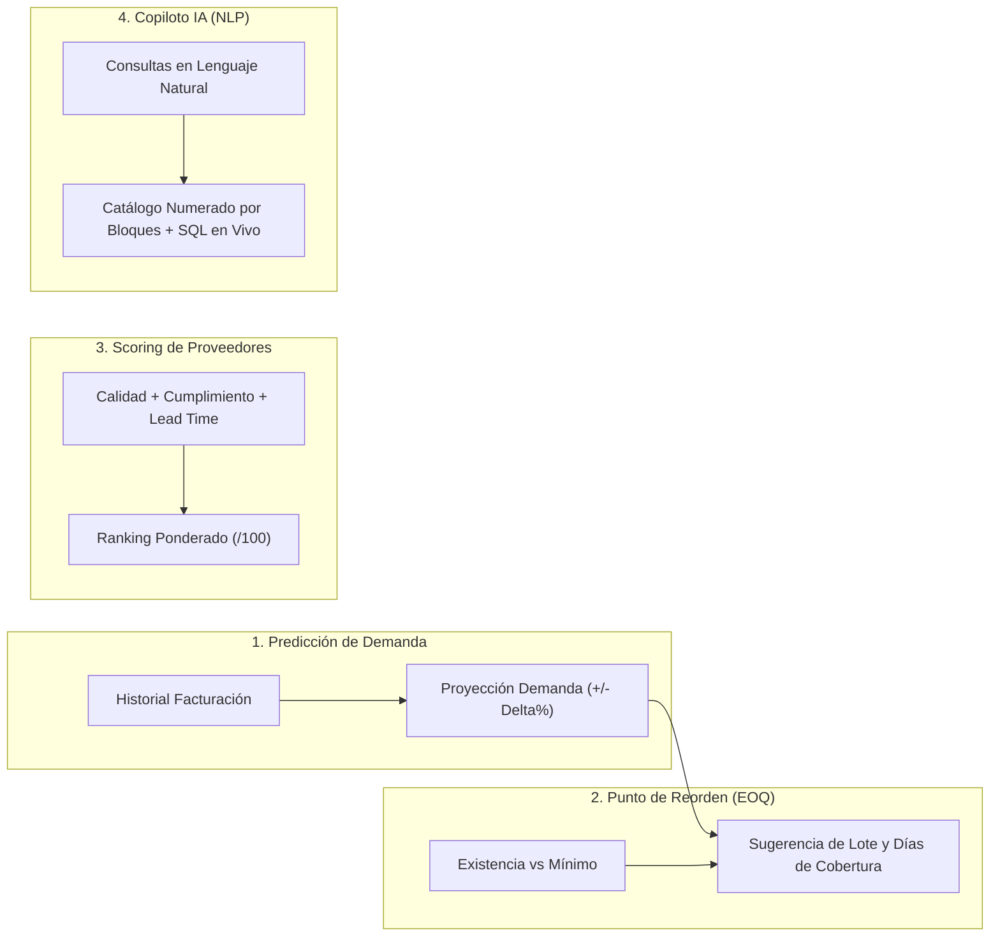

# UniControl — Resolución Integral de la Guía del Proyecto y Arquitectura del Sistema

Sistema de gestión universitario, abastecimiento inteligente e inventario valorizado (*Landed Cost*) basado en la integración relacional de 3 libros de Excel independientes y modelos predictivos de Inteligencia Artificial.

---

## 1. Resolución Detallada de la Guía del Proyecto (Guia - proyecto.docx)

### A. Objetivo Central del Negocio
La optimización del proceso de compras y abastecimiento de repuestos y accesorios automotrices resuelve de forma algorítmica las tres preguntas operativas clave planteadas en la guía:

1. **¿Qué comprar?**
   - El sistema cruza en tiempo real el inventario físico disponible en bodega (`Existencia`) contra el umbral de seguridad (`Stock_Minimo`).
   - Identifica inmediatamente los accesorios en riesgo inminente de desabasto (**Nivel Crítico**) y aquellos en zona de precaución (**Nivel Preventivo**), priorizando el pedido de repuestos de alta demanda y margen comercial.
2. **¿A quién comprar?**
   - Evalúa a los proveedores internacionales mediante un **Algoritmo de Scoring Multicriterio Dinámico**, ponderando en vivo tres dimensiones: calidad del producto ($C \in [1,5]$), cumplimiento histórico de entregas ($E \in [0,100\%]$) y velocidad de tránsito aduanal/días de entrega ($D$).
   - Selecciona automáticamente el proveedor más conveniente para cada accesorio, equilibrando costo y confiabilidad.
3. **¿Cuándo y cuánto comprar?**
   - Aplica el modelo matemático de **Punto de Reorden (EOQ)** y análisis de cobertura de demanda proyectada ($\text{Días de Cobertura} = \text{Existencia} / \text{Demanda Diaria}$).
   - Sugiere el lote óptimo de compra en unidades físicas y calcula la inversión exacta requerida a costo de internación (*Landed Cost*).

---

### B. Estructura y Vinculación Relacional de los 3 Archivos de Excel

La guía plantea la existencia de 3 fuentes de datos desconectadas que deben integrarse en un modelo relacional consistente:

| Libro Excel Original | Columnas Clave | Propósito Operativo en UniControl | Mapeo Relacional SQL (3FN) |
| :--- | :--- | :--- | :--- |
| **1. PROVEEDORES.xlsx** | `No.`, `Nombre`, `Contacto`, `NIT`, `NRC`, `Correo`, `Direccion`, `Tipo de contribuyente`, `Condiciones de pago`, `Fecha de registro` | Directorio de proveedores internacionales, tarifas y tiempos de importación desde Zona Libre (Panamá), Tailandia y Asia. | Tabla `proveedores`<br>Clave Primaria: `id_proveedor` |
| **2. FACTURACION.xlsx** | `Fecha`, `No. De factura`, `Tipo de documento`, `Proveedor`, `Cantidad`, `Descripción`, `Precio unitario`, `Descuento`, `IVA 13%`, `Total`, `No. Cotización`, `Orden de Compra` | Historial de transacciones comerciales, compras emitidas, cotizaciones y comprobantes fiscales con cálculo de IVA. | Tablas `documentos_compra` y `detalle_compras`<br>Claves: `id_documento`, `id_detalle` |
| **3. PRODUCTOS.xlsx** | `ID del producto`, `Codigo`, `Nombre`, `Descripción`, `ID de categoría`, `Marca`, `Costo Unitario`, `Flete`, `Aranceles`, `Impuestos`, `Almacenaje`, `Precio total compra`, `Precio de venta`, `Existencia`, `Ubicación` | Catálogo maestro de inventario valorizado, desglose analítico de importación (*Landed Cost*) y existencias en bodega. | Tabla `productos`<br>Clave Primaria: `id_producto` |

#### Mecanismo de Auto-Curación (*Auto-Healing*) de Integridad Referencial:
Durante la ingesta automática, el motor detecta inconsistencias entre libros y las repara antes de escribir en la base relacional:
1. Al procesar la cotización `EST-1019` en `FACTURACION.xlsx`, detectó al proveedor **`IAM IMPORT & EXPORT TRADING S.A.`**, el cual no existía en `PROVEEDORES.xlsx`. El motor generó automáticamente `id_proveedor = 4` y lo dio de alta en la tabla maestra.
2. Al procesar los accesorios **`2024 TRITON ROLL BAR CHROME`** y **`GRILLE MBG115 NG (7450B108)`**, ausentes en `PRODUCTOS.xlsx`, el motor generó las claves `PROD-013` y `PROD-014`, estimó sus costos y los insertó en `productos` antes de vincular el detalle de compra, garantizando **cero registros huérfanos**.

---

### C. Implementación de las 4 Técnicas de Inteligencia Artificial

UniControl incorpora de manera funcional las cuatro alternativas de IA descritas en la guía:



1. **Predicción de Demanda (*Demand Forecasting*):**
   - El simulador permite ajustar la proyección de variación de demanda desde $-30\%$ hasta $+100\%$, recalculando de inmediato el consumo esperado mensual y el ritmo de agotamiento de stock.
2. **Motor de Recomendación de Compras (*Reorder Point & EOQ*):**
   - Clasifica los 14 productos en estados `CRITICO`, `PREVENTIVO` y `OPTIMO`. Para cada producto crítico genera una propuesta formal de orden de compra indicando cantidad exacta y monto de inversión requerido.
3. **Algoritmo de Selección Optimizada de Proveedores (*Multi-Criteria Scoring*):**
   - Pondera calidad, cumplimiento y días de entrega con pesos dinámicos configurables:

$$\text{Score IA} = \left(\frac{\text{Calidad}}{5} \times W_{\text{calidad}}\right) + \left(\frac{\text{Cumplimiento}}{100} \times W_{\text{cumplimiento}}\right) + \left(\frac{\max(1, 35 - \text{Días})}{35} \times W_{\text{tiempo}}\right)$$

4. **Asistente de IA Integrado (*Copilot Multiconsulta*):**
   - Permite consultar en lenguaje natural cualquier información del sistema.
   - Entrega el catálogo de productos de forma **gradual y ordenada en bloques numerados** (bloques de 5 productos) para no saturar la pantalla, permitiendo avanzar paso a paso mediante botones interactivos.
   - Es capaz de responder sobre la arquitectura del software, ejecutar consultas SQL en vivo y realizar cálculos financieros.

---

### D. Componentes del Dashboard y su Mapeo en UniControl

La guía solicita la estructura de 3 paneles informativos, los cuales se implementaron dentro de la aplicación web:

1. **Panel de Diagnóstico (Pasado / Presente):** Módulo `Panel & Diagnóstico` (`#view-dashboard`) con KPIs de valor de inventario, utilidad bruta potencial, gráficos de Landed Cost apilado y salud de stock, alertas prioritarias y facturas vinculadas.
2. **Panel de Proveedores:** Módulo `Motor IA & Recompra` (`#view-ia`) con comparativa de tiempos de entrega vs. costos, calificaciones de calidad y ranking de confiabilidad en gráfica de barras horizontales.
3. **Panel Predictivo / IA (Futuro):** Módulo `Motor IA & Recompra` (`#view-ia`) con matriz completa de órdenes de compra sugeridas por IA, justificación algorítmica y modal de emisión de órdenes hacia la base relacional SQL.

---

## 2. Arquitectura Backend, Base de Datos y Despliegue en la Nube

### A. Arquitectura Backend (Patrón Serverless MVC en el Cliente)
El backend opera mediante controladores y servicios modulares en JavaScript (`assets/js/app.js`):
- **Controlador ETL e Ingesta:** Lectura binaria de hojas de cálculo vía SheetJS y resolución de relaciones entre tablas.
- **Servicio Financiero y de Costeo:** Cálculo de *Landed Cost* ($\text{FOB} + \text{Flete} + \text{Aranceles} + \text{Impuestos} + \text{Almacenaje}$) y márgenes unitarios y porcentuales.
- **Controlador Transaccional:** Registro en caliente de órdenes de compra, nuevas facturas comerciales y altas de catálogo.
- **Navegación SPA con Scroll Reset Global:** Al conmutar entre vistas (`switchView`), el sistema restablece de forma automática e inmediata la posición de desplazamiento a la parte superior (`window.scrollTo(0, 0)`), garantizando una experiencia de usuario limpia y sin desorientación.

### B. Motor de Base de Datos y Conexión
- **Motor:** **SQLite3 Relacional** ejecutado en el navegador mediante **SQL.js (WebAssembly / WASM)** bajo Tercera Forma Normal (3FN).
- **Tablas:** `categorias`, `proveedores`, `productos`, `documentos_compra`, `detalle_compras` y `recomendaciones_ia`.
- **Vistas Analíticas:** `v_relaciones_completas`, `v_analisis_rentabilidad_productos` y `v_alertas_abastecimiento_ia`.
- **Conexión:** Driver nativo WebAssembly en memoria RAM con latencia menor a `1 ms` y exportación binaria descargable en formato `.db` y script `.sql`.

### C. Despliegue en la Nube (Vercel + GitHub CI/CD)
- El repositorio está versionado en **GitHub** y conectado a la plataforma en la nube **Vercel**.
- Cada cambio en la rama principal desencadena un despliegue continuo (**CI/CD**) inmediato con certificado SSL y distribución global CDN en la URL del proyecto (`unicontrol-ten.vercel.app`).
- Los 3 libros de Excel se encuentran organizados dentro de `data/excel/` y a la vez embebidos en el código fuente, garantizando que el sistema abra y descargue los archivos con el Excel predeterminado de cualquier computadora sin errores de rutas.

---

## 3. Script SQL DDL Completo de la Base de Datos

```sql
PRAGMA foreign_keys = ON;

DROP VIEW IF EXISTS v_alertas_abastecimiento_ia;
DROP VIEW IF EXISTS v_analisis_rentabilidad_productos;
DROP VIEW IF EXISTS v_relaciones_completas;

DROP TABLE IF EXISTS recomendaciones_ia;
DROP TABLE IF EXISTS detalle_compras;
DROP TABLE IF EXISTS documentos_compra;
DROP TABLE IF EXISTS productos;
DROP TABLE IF EXISTS proveedores;
DROP TABLE IF EXISTS categorias;

CREATE TABLE categorias (
    id_categoria TEXT PRIMARY KEY,
    nombre_categoria TEXT NOT NULL,
    descripcion TEXT,
    stock_minimo_default INTEGER NOT NULL DEFAULT 8,
    factor_seguridad REAL NOT NULL DEFAULT 1.5
);

CREATE TABLE proveedores (
    id_proveedor INTEGER PRIMARY KEY,
    nombre TEXT NOT NULL UNIQUE,
    contacto TEXT,
    nit TEXT,
    nrc TEXT,
    correo TEXT,
    direccion TEXT,
    pais_origen TEXT DEFAULT 'Internacional',
    tipo_contribuyente TEXT,
    condiciones_pago TEXT DEFAULT 'CONTADO',
    fecha_registro TEXT,
    tiempo_entrega_dias INTEGER NOT NULL DEFAULT 15,
    calificacion_calidad REAL NOT NULL DEFAULT 4.5 CHECK (calificacion_calidad BETWEEN 1.0 AND 5.0),
    cumplimiento_entregas_pct REAL NOT NULL DEFAULT 95.0 CHECK (cumplimiento_entregas_pct BETWEEN 0.0 AND 100.0),
    score_ia REAL DEFAULT 0.0,
    origen_registro TEXT NOT NULL DEFAULT 'EXCEL_PROVEEDORES'
);

CREATE TABLE productos (
    id_producto TEXT PRIMARY KEY,
    codigo_sku TEXT NOT NULL,
    nombre TEXT NOT NULL,
    descripcion TEXT,
    id_categoria TEXT NOT NULL,
    id_proveedor_preferido INTEGER,
    marca TEXT,
    costo_unitario REAL NOT NULL DEFAULT 0.0,
    costo_flete REAL NOT NULL DEFAULT 0.0,
    aranceles_aduanales REAL NOT NULL DEFAULT 0.0,
    impuestos REAL NOT NULL DEFAULT 0.0,
    almacenaje REAL NOT NULL DEFAULT 0.0,
    precio_total_compra REAL NOT NULL DEFAULT 0.0,
    precio_venta REAL NOT NULL DEFAULT 0.0,
    margen_unitario REAL NOT NULL DEFAULT 0.0,
    margen_porcentaje REAL NOT NULL DEFAULT 0.0,
    existencia INTEGER NOT NULL DEFAULT 0,
    stock_minimo INTEGER NOT NULL DEFAULT 8,
    punto_reorden INTEGER NOT NULL DEFAULT 12,
    ubicacion TEXT DEFAULT 'Bodega Central',
    estado TEXT DEFAULT 'Disponible',
    fecha_ingreso TEXT,
    fecha_salida TEXT,
    origen_registro TEXT NOT NULL DEFAULT 'EXCEL_PRODUCTOS',
    FOREIGN KEY (id_categoria) REFERENCES categorias(id_categoria)
        ON UPDATE CASCADE ON DELETE RESTRICT,
    FOREIGN KEY (id_proveedor_preferido) REFERENCES proveedores(id_proveedor)
        ON UPDATE CASCADE ON DELETE SET NULL
);

CREATE TABLE documentos_compra (
    id_documento INTEGER PRIMARY KEY AUTOINCREMENT,
    numero_factura TEXT NOT NULL UNIQUE,
    fecha TEXT NOT NULL,
    tipo_documento TEXT NOT NULL,
    id_proveedor INTEGER NOT NULL,
    numero_cotizacion TEXT,
    orden_compra TEXT,
    subtotal_documento REAL NOT NULL DEFAULT 0.0,
    iva_documento REAL NOT NULL DEFAULT 0.0,
    total_documento REAL NOT NULL DEFAULT 0.0,
    FOREIGN KEY (id_proveedor) REFERENCES proveedores(id_proveedor)
        ON UPDATE CASCADE ON DELETE RESTRICT
);

CREATE TABLE detalle_compras (
    id_detalle INTEGER PRIMARY KEY AUTOINCREMENT,
    id_documento INTEGER NOT NULL,
    id_producto TEXT NOT NULL,
    descripcion_factura TEXT NOT NULL,
    cantidad INTEGER NOT NULL CHECK (cantidad > 0),
    precio_unitario REAL NOT NULL DEFAULT 0.0,
    descuento REAL NOT NULL DEFAULT 0.0,
    iva_13 REAL NOT NULL DEFAULT 0.0,
    iva_retenido REAL NOT NULL DEFAULT 0.0,
    iva_percibido REAL NOT NULL DEFAULT 0.0,
    total_linea REAL NOT NULL DEFAULT 0.0,
    metodo_vinculacion TEXT NOT NULL DEFAULT 'MATCH_EXACTO',
    FOREIGN KEY (id_documento) REFERENCES documentos_compra(id_documento)
        ON UPDATE CASCADE ON DELETE CASCADE,
    FOREIGN KEY (id_producto) REFERENCES productos(id_producto)
        ON UPDATE CASCADE ON DELETE RESTRICT
);

CREATE TABLE recomendaciones_ia (
    id_recomendacion INTEGER PRIMARY KEY AUTOINCREMENT,
    id_producto TEXT NOT NULL,
    id_proveedor_sugerido INTEGER NOT NULL,
    nivel_alerta TEXT NOT NULL,
    prioridad INTEGER NOT NULL,
    existencia_actual INTEGER NOT NULL,
    stock_minimo INTEGER NOT NULL,
    punto_reorden INTEGER NOT NULL,
    demanda_mensual_estimada REAL NOT NULL,
    dias_cobertura_estimados INTEGER NOT NULL,
    cantidad_sugerida_compra INTEGER NOT NULL,
    costo_unitario_estimado REAL NOT NULL,
    inversion_total_sugerida REAL NOT NULL,
    score_proveedor REAL NOT NULL,
    justificacion_ia TEXT NOT NULL,
    fecha_calculo TEXT NOT NULL,
    FOREIGN KEY (id_producto) REFERENCES productos(id_producto)
        ON UPDATE CASCADE ON DELETE CASCADE,
    FOREIGN KEY (id_proveedor_sugerido) REFERENCES proveedores(id_proveedor)
        ON UPDATE CASCADE ON DELETE RESTRICT
);

CREATE INDEX idx_productos_categoria ON productos(id_categoria);
CREATE INDEX idx_productos_proveedor ON productos(id_proveedor_preferido);
CREATE INDEX idx_documentos_proveedor ON documentos_compra(id_proveedor);
CREATE INDEX idx_detalle_documento ON detalle_compras(id_documento);
CREATE INDEX idx_detalle_producto ON detalle_compras(id_producto);
CREATE INDEX idx_recomendaciones_alerta ON recomendaciones_ia(nivel_alerta, prioridad);

CREATE VIEW v_relaciones_completas AS
SELECT 
    dc.id_detalle,
    doc.numero_factura,
    doc.tipo_documento,
    doc.fecha AS fecha_documento,
    doc.orden_compra,
    doc.numero_cotizacion,
    prov.id_proveedor,
    prov.nombre AS nombre_proveedor,
    prov.pais_origen AS pais_proveedor,
    prod.id_producto,
    prod.codigo_sku,
    prod.nombre AS nombre_producto_catalogo,
    dc.descripcion_factura AS descripcion_en_excel_factura,
    cat.id_categoria,
    cat.nombre_categoria,
    dc.cantidad,
    dc.precio_unitario,
    dc.iva_13,
    dc.total_linea,
    dc.metodo_vinculacion
FROM detalle_compras dc
INNER JOIN documentos_compra doc ON dc.id_documento = doc.id_documento
INNER JOIN proveedores prov ON doc.id_proveedor = prov.id_proveedor
INNER JOIN productos prod ON dc.id_producto = prod.id_producto
INNER JOIN categorias cat ON prod.id_categoria = cat.id_categoria;

CREATE VIEW v_analisis_rentabilidad_productos AS
SELECT 
    p.id_producto,
    p.codigo_sku,
    p.nombre,
    c.nombre_categoria,
    p.marca,
    pr.nombre AS proveedor_preferido,
    p.costo_unitario,
    (p.costo_flete + p.aranceles_aduanales + p.impuestos + p.almacenaje) AS gastos_importacion,
    p.precio_total_compra AS costo_landed_total,
    p.precio_venta,
    p.margen_unitario,
    p.margen_porcentaje,
    p.existencia,
    p.stock_minimo,
    p.punto_reorden,
    ROUND(p.existencia * p.precio_total_compra, 2) AS valor_inventario_costo,
    ROUND(p.existencia * p.precio_venta, 2) AS valor_inventario_venta,
    p.ubicacion
FROM productos p
INNER JOIN categorias c ON p.id_categoria = c.id_categoria
LEFT JOIN proveedores pr ON p.id_proveedor_preferido = pr.id_proveedor;

CREATE VIEW v_alertas_abastecimiento_ia AS
SELECT 
    r.id_recomendacion,
    r.nivel_alerta,
    r.prioridad,
    p.id_producto,
    p.codigo_sku,
    p.nombre AS producto,
    c.nombre_categoria AS categoria,
    r.existencia_actual,
    r.stock_minimo,
    r.punto_reorden,
    r.dias_cobertura_estimados,
    r.cantidad_sugerida_compra,
    r.costo_unitario_estimado,
    r.inversion_total_sugerida,
    pr.id_proveedor,
    pr.nombre AS proveedor_recomendado,
    pr.tiempo_entrega_dias,
    pr.calificacion_calidad,
    pr.cumplimiento_entregas_pct,
    r.score_proveedor,
    r.justificacion_ia
FROM recomendaciones_ia r
INNER JOIN productos p ON r.id_producto = p.id_producto
INNER JOIN categorias c ON p.id_categoria = c.id_categoria
INNER JOIN proveedores pr ON r.id_proveedor_sugerido = pr.id_proveedor
ORDER BY r.prioridad ASC, r.inversion_total_sugerida DESC;
```
